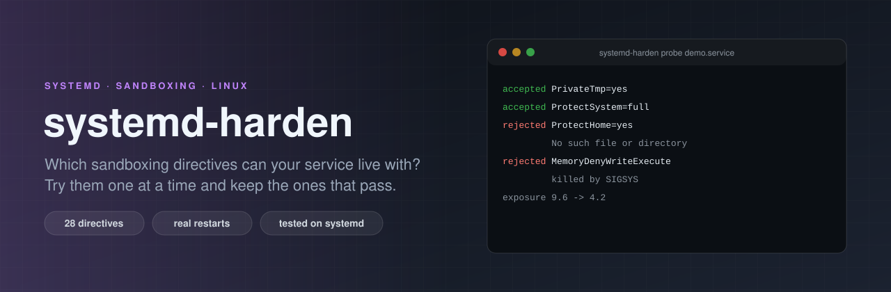

<p align="center"></p>

# systemd-harden

[](https://github.com/ErenOzgu/systemd-harden/actions/workflows/ci.yml)


**Find out which systemd sandboxing directives a service really survives.** systemd can lock a service down with
dozens of one-line settings (`ProtectSystem=`, `PrivateTmp=`, `MemoryDenyWriteExecute=`, ...), and `systemd-analyze
security` tells you which ones are missing. What it cannot tell you is which ones your service can live with.
systemd-harden finds out by trying: it adds one directive at a time to the running service, restarts it, runs your
health check, and keeps the directive only if the service still works. The result is a drop-in file with the
directives that passed, and for each one that did not, the reason and a likely cause.

Python standard library only. It needs Linux with systemd as the init system, root, and a service you can restart.

## Why

Hardening a service by hand means guessing. You add `ProtectSystem=strict`, the service starts, and an hour later a
write to `/var/lib` fails. You add `MemoryDenyWriteExecute=yes` and the process dies with `SIGSYS` and no hint why.
So most services stay unhardened, or get a copied block of directives that someone once tested on another program.
This tool replaces the guessing with an experiment you can repeat: the same service, the same health check, one
change at a time, and a record of what broke.

## Try it

Use a test machine or a VM: the probe restarts the service about forty times. The demo service in this repository is a
small TCP server whose "features" use things that directives can take away (reading `/home`, writing `/var/lib`, ...).

```sh
pip install git+https://github.com/ErenOzgu/systemd-harden
git clone https://github.com/ErenOzgu/systemd-harden && cd systemd-harden
sudo examples/demo/setup.sh up           # installs and starts sdh-demo.service (under /run: a reboot removes it)

# The health check reads a file under /home, writes under /var/lib and uses /tmp.
sudo systemd-harden probe sdh-demo.service --allow-restart \
     --check "python3 /usr/local/lib/systemd-harden-demo/service.py check tmp,home,var" -o hardening.conf

sudo examples/demo/setup.sh down
```

The probe writes its drop-in under `/run`, so a crash can never leave a permanent change, and it puts the service back
as it found it. The file `hardening.conf` is yours: install it as `/etc/systemd/system/NAME.service.d/10-hardening.conf`
and run `systemctl daemon-reload && systemctl restart NAME.service`.

## How a probe works

1. **Baseline.** The service is restarted with no change and the health check must pass. If it does not, nothing that
   follows would mean anything, and the probe stops (exit status 4) and says why.
2. **One directive at a time.** For every directive in the table below, the strongest setting is written to a drop-in,
   systemd reloads, the service restarts and must still be running after `--settle` seconds, and the health check
   must pass. If it fails, the next weaker setting is tried (`ProtectHome=yes`, then `ProtectHome=read-only`). A
   directive that systemd does not know, or that another drop-in overrides, is skipped and said so rather than
   counted as a pass.
3. **Together.** The directives that passed alone are applied together. When that works, that is the answer. When it
   does not, they are added one by one in table order and the ones that break the set are dropped, with the reason.
4. **Final check.** The final set is restarted and checked `--rounds` times, and `systemd-analyze security` is asked
   for the exposure level before and after.
5. **Put back.** The probe drop-in is removed, systemd reloads, and the service is restarted if it was running or
   stopped if it was not.

The directives, strongest setting first:

<!-- catalogue:start -->
| Directive | Tried in this order | What it takes away |
| --- | --- | --- |
| `NoNewPrivileges` | `NoNewPrivileges=yes` | The service and its children can never gain privileges through setuid binaries or file capabilities. |
| `PrivateTmp` | `PrivateTmp=yes` | The service gets its own /tmp and /var/tmp, invisible to others and cleaned up when it stops. |
| `ProtectSystem` | `ProtectSystem=strict`<br>`ProtectSystem=full`<br>`ProtectSystem=yes` | The operating system's directories become read-only for the service (strict: the whole file system except /dev, /proc and /sys). |
| `ProtectHome` | `ProtectHome=yes`<br>`ProtectHome=read-only` | /home, /root and /run/user are made inaccessible or read-only. |
| `PrivateDevices` | `PrivateDevices=yes` | The service sees only the harmless pseudo devices (null, zero, random, ...) in /dev, not disks or hardware. |
| `DevicePolicy` | `DevicePolicy=closed` | Access to device nodes is limited to the usual pseudo devices. |
| `ProtectKernelTunables` | `ProtectKernelTunables=yes` | /proc/sys, /sys and similar kernel knobs are read-only. |
| `ProtectKernelModules` | `ProtectKernelModules=yes` | The service cannot load or unload kernel modules. |
| `ProtectKernelLogs` | `ProtectKernelLogs=yes` | The service cannot read the kernel log ring buffer. |
| `ProtectControlGroups` | `ProtectControlGroups=yes` | The control group hierarchy is read-only. |
| `ProtectClock` | `ProtectClock=yes` | The service cannot change the system clock or the hardware clock. |
| `ProtectHostname` | `ProtectHostname=yes` | The service cannot change the host name. |
| `ProtectProc` | `ProtectProc=invisible + ProcSubset=pid`<br>`ProtectProc=invisible` | Other users' processes are hidden in /proc, and only process directories are shown. |
| `RestrictSUIDSGID` | `RestrictSUIDSGID=yes` | The service cannot create files with the set-user-ID or set-group-ID bit. |
| `RestrictRealtime` | `RestrictRealtime=yes` | The service cannot ask for realtime scheduling. |
| `RestrictNamespaces` | `RestrictNamespaces=yes` | The service cannot create new namespaces, a common step in container escapes. |
| `LockPersonality` | `LockPersonality=yes` | The service cannot change its execution domain. |
| `MemoryDenyWriteExecute` | `MemoryDenyWriteExecute=yes` | Memory cannot be both writable and executable, which stops most injected code. |
| `RemoveIPC` | `RemoveIPC=yes` | The service's System V and POSIX IPC objects are removed when it stops. |
| `RestrictAddressFamilies` | `RestrictAddressFamilies=AF_UNIX`<br>`RestrictAddressFamilies=AF_UNIX AF_INET AF_INET6` | Only the listed socket families can be opened (first try: Unix sockets only, then Unix plus IPv4 and IPv6). |
| `SystemCallArchitectures` | `SystemCallArchitectures=native` | Only native system calls are allowed, which closes the 32-bit compatibility door on 64-bit machines. |
| `SystemCallFilter` | `SystemCallFilter=@system-service + SystemCallFilter=~@privileged @resources`<br>`SystemCallFilter=@system-service`<br>`SystemCallFilter=~@clock @debug @module @mount @obsolete @raw-io @reboot @swap` | Only the system calls a normal service needs are allowed (first try also without privileged and resource-control calls). |
| `CapabilityBoundingSet` | `CapabilityBoundingSet=`<br>`CapabilityBoundingSet=CAP_NET_BIND_SERVICE` | The service runs with no Linux capabilities at all (second try: only the one for binding ports below 1024). |
| `PrivateUsers` | `PrivateUsers=yes` | The service sees only itself and root in user and group lists, and runs in a user namespace. |
| `PrivateNetwork` | `PrivateNetwork=yes` | The service gets an empty network namespace with only a loopback device (it can not be reached from outside). |
| `IPAddressDeny` | `IPAddressDeny=any + IPAddressAllow=localhost`<br>`IPAddressDeny=any + IPAddressAllow=localhost + IPAddressAllow=link-local + IPAddressAllow=multicast` | The service can only talk to the local host (first try) or the local network. |
| `KeyringMode` | `KeyringMode=private` | The service gets its own kernel keyring, not shared with other services. |
| `UMask` | `UMask=0077` | Files the service creates are private to its user by default. |
<!-- catalogue:end -->

## Commands

| Command | What it does |
| --- | --- |
| `systemd-harden probe UNIT --check CMD --allow-restart` | Try the directives, write the drop-in to standard output (or `-o FILE`) and a table to standard error. |
| `systemd-harden verify UNIT --dropin FILE --check CMD --allow-restart` | Apply a drop-in file once more and check the service: a regression test for hardening you already have. |
| `systemd-harden cleanup` | Remove probe drop-ins that a killed run left under `/run/systemd/system`. |
| `systemd-harden catalogue` | List the directives and the settings tried. |

Options of `probe` and `verify`:

| Option | Meaning |
| --- | --- |
| `--check COMMAND` | The health check: a command that exits 0 while the service works. It is run without a shell. |
| `--allow-restart` | Required. Says that restarting the service many times is fine here. |
| `--allow-critical` | Allow units such as `sshd`, `dbus` and `systemd-*`, which are refused by default. |
| `--settle SECONDS` | How long a started service must stay up before the check (default 1.5). |
| `--check-timeout SECONDS` | Give up on a health check after this long (default 30). |
| `--start-timeout SECONDS` | Give up on a restart after this long (default 90). |
| `--rounds N` | How often the final set is restarted and checked (default 2). |
| `--oneshot` | The service runs and exits (`Type=oneshot`): do not require it to stay active. |
| `--only A,B` / `--skip A,B` | Try only these directives, or leave these out. |
| `--dropin FILE` | (`verify`) The drop-in to apply, as written by `probe`. |
| `-o FILE`, `--output FILE` | (`probe`) Write the drop-in to a file instead of standard output. |
| `--json FILE` | (`probe`) Also write the full result as JSON. |
| `-q`, `--quiet` | (`probe`) No progress lines. |

Exit status: 0 done, 1 the final set did not hold up, the service could not be put back, or `verify` failed, 2 the
command line or the refusal to start (no `--allow-restart`, a critical unit), 3 this machine cannot do it (not root,
not systemd, unit not loaded), 4 the service is unhealthy before any change, 130 interrupted.

## A good health check is the whole game

The probe can only know what the check tells it. A check that only asks "is the port open?" lets through a directive
that breaks the one request that writes to disk. Make the check do the things the service is for: log in, write a
record, read it back, call the endpoint that uses the network. Several short commands can go in one script. If the
service has a test suite for its behaviour, run that.

## Keeping the hardening honest

Once the drop-in is in your repository, `verify` can run in CI on every change, on a runner that has systemd:

<!-- include:examples/ci/verify.yml -->
```yaml
# A pull request check for a repository that ships a systemd service and its hardening drop-in: install the
# service the way you deploy it, then prove it still passes its health check with the drop-in applied.
name: Hardening still holds

on:
  pull_request:

permissions:
  contents: read

jobs:
  verify:
    runs-on: ubuntu-latest
    steps:
      - uses: actions/checkout@v4
      - uses: actions/setup-python@v5
        with:
          python-version: "3.12"
      - run: pip install git+https://github.com/ErenOzgu/systemd-harden
      - name: Install and start the service
        run: |
          sudo install -D -m 0644 deploy/myapp.service /run/systemd/system/myapp.service
          sudo systemctl daemon-reload
          sudo systemctl start myapp.service
      - name: The drop-in still lets it work
        run: |
          sudo -E env "PATH=$PATH" systemd-harden verify myapp.service \
            --dropin deploy/myapp.hardening.conf \
            --check "curl -fsS http://127.0.0.1:8080/health" \
            --allow-restart
```

A change that starts using a path the drop-in has made read-only then fails the pull request instead of a deployment.

## How it is tested

- The whole algorithm runs against a simulated machine (`tests/fake.py`): a service whose behaviour depends on the
  drop-in it is given. That is where weaker candidates, directives that conflict, a service that dies after the
  settle time, an old systemd, a failed restore, a flaky final set, an interrupt in the middle and every refusal are
  tested, without touching a real service.
- The parsing of `systemctl`, `journalctl` and `systemd-analyze` output, the drop-in file handling and the health
  check execution are tested against stand-in executables.
- **Real systemd.** On GitHub's Ubuntu runners (22.04 with systemd 249 and 24.04 with systemd 255 on x86-64, and 24.04
  on arm64) the demo service is installed, probed and verified for real, and the tests assert what systemd does:
  `ProtectHome=yes` breaks a service that reads `/home` while `read-only` does not, `ProtectSystem=strict` breaks one
  that writes under `/var/lib` while `full` does not, `MemoryDenyWriteExecute=yes`, `RestrictNamespaces=yes` and
  `ProtectKernelTunables=yes` break the services that need them, and afterwards the unit runs as before with no probe
  drop-in left. A skipped live test is a failure in CI.
- The README is checked against the code: the table of directives is generated from the catalogue, the option
  table lists every option the command line has, and the CI example is the committed file.

## What it cannot do

- **It only knows what the health check exercises.** A directive that breaks a path your check never takes will be
  kept. The drop-in is a starting point you still review, not a certificate.
- **It restarts the service many times.** Do not point it at something that must stay up. Units such as sshd, dbus
  and systemd's own are refused unless you say `--allow-critical`.
- **It does not tune.** It decides yes or no for a fixed list of directives and their usual weaker variants. It does
  not work out `ReadWritePaths=`, `StateDirectory=`, an allow list of system calls or the narrowest capability set.
  When `ProtectSystem=strict` is rejected because the service writes to one directory, the report says so and you can
  add that directory yourself and run the probe again.
- **The combination search is greedy.** Directives are added in table order, so a different order could keep a
  different, possibly larger set when two directives conflict. It does not search for the best one.
- **List-valued directives are not read back.** For single-word settings it checks with `systemctl show` that the
  directive really is in effect. `SystemCallFilter`, `RestrictAddressFamilies`, `CapabilityBoundingSet` and
  `IPAddressDeny` are trusted to have been applied when the drop-in was.
- **The directive list is fixed and finite.** Newer settings (for example `RestrictFileSystems=`, `PrivateIPC=`,
  `ProtectHome=tmpfs`) are not in it. Directives that need systemd newer than the running one are skipped by a table
  of first versions, which was written from the documentation and not re-checked against every release.
- **Services only.** User services, sockets, timers and containers are not handled. `Type=oneshot` works with
  `--oneshot` and was tested only in the simulation. Socket-activated services were not tried.
- **Exposure levels are information.** The number comes from `systemd-analyze security`, which has its own opinion of
  what is exposed, and its output format has changed between systemd versions.
- **Only these systems were tried.** Ubuntu 22.04 and 24.04 on GitHub runners. Other distributions, systemd 256 and
  later, and machines where `/run/systemd/system` is not writable were not.
- **A killed probe leaves its drop-in until you run `systemd-harden cleanup`** (or reboot, because it lives under
  `/run`). The service then keeps the last tried directive until its next restart.
- **Root and a running systemd are required.** Everything is refused otherwise, with exit status 3.

## Layout

```
systemd_harden/    catalogue.py (the directives), probe.py (the algorithm), system.py (systemctl and friends),
                   diagnose.py (failure hints), report.py, cli.py
tests/             simulated machine, stand-in executables, live tests against real systemd
examples/demo/     the demo service, its unit and setup.sh
examples/ci/       a pull request workflow that runs `verify`
```

## License

MIT, see [LICENSE](LICENSE).
